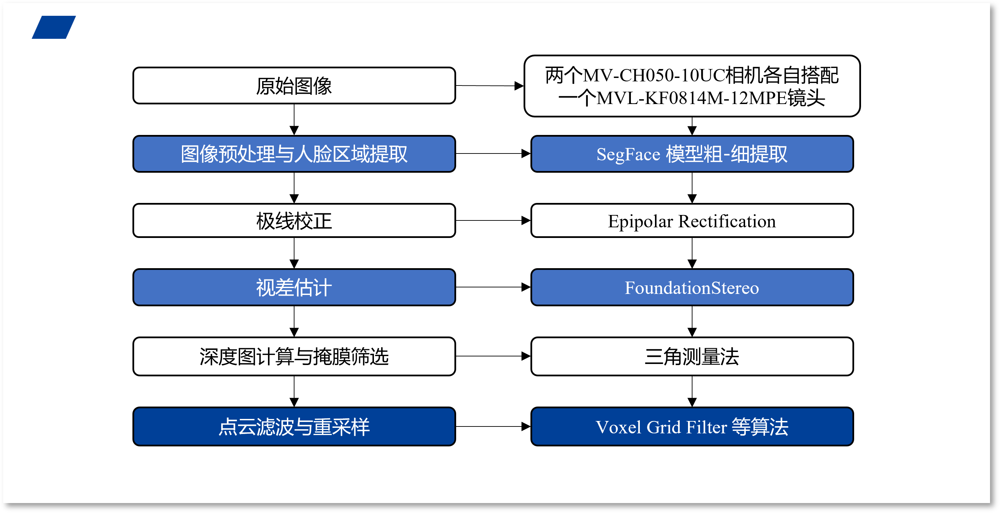

# SFStereoNet

SFStereoNet 是一个**高精度双目人脸三维重建系统**，通过软硬件协同优化，在 FaceScape 数据集上实现了**亚毫米级重建精度（0.4 mm 内）**。  
系统采用 **SegFace** 模型提升面部语义分割精度，并结合 **NVIDIA FoundationStereo** 实现高精度视差估计。  
在硬件方面，平台由 **MVL-KF0814M-12MPE 镜头**与 **MV-CH050-10UC 相机**组成双目视觉系统，配合高精度夹持装置，确保数据采集稳定性与一致性。  
计算平台包括 **NVIDIA RTX 3060 GPU** 与 **AMD Ryzen 7 5800H CPU**，基于 **WSL2** 环境进行开发与训练。  
本系统可广泛应用于**高精度人脸建模、表情重建、医学影像、数字人生成**等领域。

---

## 📦 数据与模型

系统整合了 **FaceScape、SegFace、FoundationStereo** 三大核心组件，形成了兼具数据多样性、语义细粒度与几何精度的三维人脸重建体系。

---

### 📚 FaceScape 数据集（CVPR 2020 / TPAMI 2023）

[FaceScape](https://facescape.nju.edu.cn/) 是目前规模最大、精度最高的三维人脸数据集之一，包含：

- **847 名受试者 × 20 种表情**，共 16,940 个拓扑一致的 3D 人脸模型；
- 每个样本含 **高分辨率多视角图像**、**精确相机参数**、**4K 位移纹理贴图**；
- 数据覆盖性别、年龄等人群维度；
- 提供 **Bilinear 参数模型**、**渲染工具链**、**配准工具**。

> 在本工程中，FaceScape 用于提供 **真值三维形状** 与 **仿真多视角观测数据**，支撑基于真实参数的验证实验。

---

### 🎯 SegFace（AAAI 2025）：长尾类别人脸语义分割

[SegFace](https://huggingface.co/kartiknarayan/SegFace) 是首个专注于人脸分割中**长尾类别**（耳朵，眉毛，鼻翼，耳环，眼镜，帽子等）的模型，主要特征包括：

- 🧩 **类特定可学习 token**：针对稀有类独立建模；
- ⚙️ **轻量化结构**：移动端 >95 FPS；
- 🧠 **多尺度融合与跨注意力机制**：平衡头部与长尾区域；
- 🏆 在 CelebAMask-HQ 与 LaPa 上刷新 SOTA （最高 93.03 mean F1）。

> 在本项目中，SegFace 用于**面部掩膜生成**，辅助 FoundationStereo 剔除背景噪声并提升几何一致性。

---

### 🌍 FoundationStereo（CVPR 2025）：通用零样本立体匹配

[FoundationStereo](https://github.com/NVlabs/FoundationStereo) 是 NVIDIA 提出的立体匹配基础模型，具备**零样本泛化能力**，在 Middlebury 与 ETH3D 排行榜上均获 SOTA。其特征包括：

- 🧠 **侧调谐结构**：迁移单目视觉先验；
- 🌀 **百万级自净训练集**；
- 🔭 **长程上下文滤波**；
- 🧩 **跨场景稳健视差估计**；
- 🚀 **ONNX / TensorRT 加速推理**。

> FoundationStereo 为系统的**核心深度重建模块**，确保跨设备与多场景的稳定性能，实现**域泛化**与**可迁移**的人脸立体重建。

---

## ⚙️ 系统流程

  

**主要步骤：**

1. 多视角输入采集（FaceScape 渲染或真实双目采集）；  
2. 语义分割（SegFace）提取面部掩膜；  
3. 视差估计（FoundationStereo）生成密集视差图；  
4. 深度计算与点云融合；  
5. 使用 CloudCompare 与真值网格进行配准并计算误差。

---

## 📊 实验结果

在 FaceScape 数据集的多个表情与人物下，系统表现如下：

  

> 图示说明：左为 FoundationStereo 输出点云，右为 FaceScape 真值网格。系统在鼻翼、下颌等高曲率区域仍保持出色的几何精度。

### 精度评估

为评估双目人脸三维重建算法的精度，本文统计了重建点云中每个点到真实网格表面的欧氏距离，并计算了其平均值、均方根误差（RMS）、标准差（STD）、异常点比例（Outlier Ratio）及 Hausdorff 距离等指标。结果如表所示。

由统计结果可见，大多数表情下的平均误差均保持在 1 mm 以内，整体均方根误差约为 1.63 mm，标准差约为 1.60×10⁻⁵，说明点云重建的精度较高且稳定。除“愤怒”表情外，其余表情误差差异较小，平均 Hausdorff 距离约为 26.7 mm，表明整体模型轮廓重建较为准确。

此外，为验证配准策略对精度的影响，我们选取了一个典型样例使用 **CloudCompare** 进行精细对齐，其计算结果如下所示：

由 CloudCompare 的计算结果可见，经过精细配准后，点云与真实网格之间的平均距离由约 0.8 mm 降低至 0.35 mm，标准差约为 1.002 mm，最大误差为 1.072 mm。这说明本文所提出的双目人脸重建方法在经过高精度对齐后，能够显著提升重建精度。

综上所述，本算法在未进行复杂配准的情况下已能实现亚毫米级精度，重建质量可达到医疗器械工程级别应用。

---

## 🧭 通用性与扩展性

凭借 FoundationStereo 的零样本匹配与 SegFace 的跨域分割优化，系统具有极强的**通用性**：

- 无需重新训练即可适配不同人物与相机；  
- 适用于医疗扫描、文化遗产数字化、虚拟人建模等场景；  
- 仅调整相机参数即可迁移到任意双目系统。

---

## 🤝 贡献与支持

欢迎贡献！  
若希望改进算法或扩展数据处理模块，请提交 Merge Request 或 Issue。  
项目问题可通过 [GitLab Issue 系统](https://gitlab.neuroxess.com/grape/grape-python/-/issues) 反馈。

---

## 🧑‍💻 作者与致谢

本项目由作者本人独立开发，感谢 FaceScape、SegFace、FoundationStereo 团队提供开源支持。

---

## 📚 参考文献

[1] H. Yang *et al.* “FaceScape: A Large-Scale High Quality 3D Face Dataset and Detailed Riggable 3D Face Prediction,” *CVPR*, 2020.  
[2] H. Zhu *et al.* “FaceScape: 3D Facial Dataset and Benchmark for Single-View 3D Face Reconstruction,” *IEEE TPAMI*, 2023.  
[3] K. Narayan *et al.* “SegFace: Face Segmentation of Long-Tail Classes,” *AAAI*, 2025.  
[4] B. Wen *et al.* “FoundationStereo: Zero-Shot Stereo Matching,” *CVPR*, 2025.

---

## 📄 License

本项目仅限学术研究使用，禁止商业用途。  
若需引用或扩展，请遵守各依赖项目的 License 条款。
